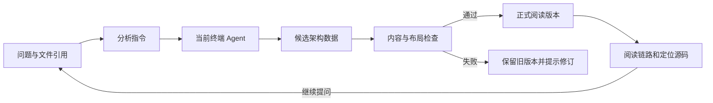

# Termdock 架构分析与图解体验融合设计

设计稿 · 2026 年 10 月 14 日

Termdock 的架构功能应帮助用户理解一个项目、模块或具体功能：从问题和文件引用开始，得到有源码依据的解释，沿关键链路阅读，再针对局部继续提问和修订。此次设计吸收 Archify、Diagram Design、Fireworks Tech Graph 的不同优势，形成统一的原生体验。

产品中心是用户的问题、分析范围和阅读结果。OMM 等外部格式保留为兼容入口，展示方式、分析能力和后续演进由 Termdock 自己定义。本文约定后续方向和验收标准，尚未实施这些新增能力。

## 产品目标

优先服务三类需求：

1. **了解结构。** 新接手项目时，快速找到入口、核心模块、存储和外部依赖，按需要展开。
2. **理解功能。** 针对某个目录中的登录、粘贴、上传或重试功能，理解触发条件、主流程、分支与边界。
3. **讨论改动。** 比较已有架构与拟议方案，定位改变了哪些职责和连接，保留依据与未确认事项。

生成整库分析只是入口之一。一个大项目中的局部问题，应该能用少量目录引用和一句问题表达，不要求用户先了解项目全貌、手输路径或选择第三方文档格式。

衡量体验的核心问题是：用户能否找到入口、读懂主线、定位源码、继续细化，以及返回原来的阅读位置。增加图种和导出格式应服务这些需求。

## 三个项目值得借鉴的能力

| 项目 | 有依据的优势 | Termdock 的承接方向 |
| --- | --- | --- |
| [Archify](https://github.com/tt-a1i/archify) | 用有类型的结构化数据表达不同图种；提供节点聚焦、路径及上游下游探索；支持源码依据与经过校验的交付。 | 围绕阅读问题选择图种；让用户沿已记录的连接探索功能；保存结构、源码依据和阅读位置。 |
| [Diagram Design](https://github.com/cathrynlavery/diagram-design) | 先选择要表达的语义，再选择布局；强调主次、品牌一致性和连接线可读性。 | 总览与细节分层，突出当前阅读主线；使用 Termdock 的配色与字体；把文本、图例、箭头和节点一起纳入布局检查。 |
| [Fireworks Tech Graph](https://github.com/yizhiyanhua-ai/fireworks-tech-graph) | 区分技术语义与视觉样式；对 SVG 进行几何和构图校验；提供静态图与离线阅读输出。 | 先保证关系含义正确，再处理样式；建立可验证的布局质量标准，逐步提供便于文档和讨论使用的导出。 |

这些优势不需要整套照搬。Archify 的独立 HTML、Diagram Design 的出版型图稿、Fireworks 的 SVG 输出各有用途；Termdock 的主要场景是项目终端里的持续分析与阅读。原生工作区应统一，导出文件可以适配其他场景。

不将第三方的主题数量、图种数量或安装方式直接变成产品菜单。优先吸收解决当前问题的方法，再按实际需求增加能力。既有 OMM 工作保留下来的递归文档、局部分析、历史和引用仍可复用。

## 现有能力与主要差距

现有实现已有范围选择、文件树引用、多视角、嵌套模块、源码跳转、文档编辑、历史和导入导出。参考 [既有验收记录](architecture-parity.md)；当前代码位置如下。

| 现有基础 | 实现位置 | 后续需要补齐 |
| --- | --- | --- |
| 项目、模块、功能范围和问题输入 | [ArchitectureGenerationForm.tsx](../src/lib/components/sidebar/ArchitectureGenerationForm.tsx) | 让问题与引用成为主入口，降低配置负担；提示词应说明为什么采用某种表达方式。 |
| 节点、连接、层级和源码引用 | [document.ts](../src/server/architecture/document.ts) | 连接目前主要是起点、终点和标签，缺少调用、依赖、数据、事件等语义；源码引用只有路径和单行定位。 |
| 多视角与全部视角组合 | [overview.ts](../src/lib/architecture/overview.ts) | 同一组件在不同视角中的身份需要关联；全部视角是组合展示，不应冒充一条业务链路。 |
| 可缩放关系图与节点阅读 | [ArchitectureDiagram.tsx](../src/lib/components/sidebar/ArchitectureDiagram.tsx) | 结构关系目前统一生成自上而下的流程图；时序、状态等问题缺少专用表达，也缺少搜索和路径探索。 |
| 原生保存、历史和字段编辑 | [store.ts](../src/server/architecture/store.ts)、[fieldMutation.ts](../src/server/architecture/fieldMutation.ts) | 已有格式与修订检查，但尚未建立完整的语义、源码依据和几何质量检查流程。 |

因此，下一步重点是补齐表达能力和阅读工具，同时增强生成内容的依据。单纯修改配色，或把更多信息塞进节点说明，不能解决这些差距。

## 用户动线

### 从问题和引用开始分析

在现有「架构」工作区内准备分析，不新增独立应用。保留目前的入口显示设置，并支持从文件页已有的目录、文件和行引用进入分析准备。

默认准备区包含当前项目、用户问题、已选范围和主要操作。例如：

> 分析 `src/lib/components/terminal` 下的图片粘贴流程，解释上传失败后的处理，并找到对应源码。

桌面在左侧复用现有文件树，右侧编写问题；树的搜索、展开和引用行为与文件页一致。目录引用表示范围，不需要展开后逐个选中所有文件。已选项展示为可移除的引用，手输路径保留为补充方式。

手机选择范围时进入单独的目录选择层，确认后回到问题输入。取消、遮罩关闭和 Escape 不改变原选择。父表单保留问题与焦点，不能因为浏览目录而把主要操作挤到屏幕之外。

依赖深度、排除范围和补充要求放在可选设置中。用户可以表达「只看所选目录内的实现」或「跟进相关调用」，无需先选择底层图类型。准备指令继续复用当前终端 Agent；放入输入区与发送须明确区分，准备指令本身不自动执行分析。

### 先读总览再沿主线展开

结果先回答这项功能做什么、从哪里进入、主要涉及哪些部分。默认显示一张有主次的总览；完整实现保留在下一级，不以缩小文字容纳所有节点。

阅读一个功能时，用户应能：

- 搜索组件名称、职责或已有源码路径，并定位对应节点。
- 从节点查看相关连接，选择追踪上游或下游。
- 指定起点与终点，查看已有有向关系中的可达路径。
- 按步骤阅读一条已明确记录的业务链路，查看每步的职责、条件和源码。
- 在结构、调用流程、时序等相关视角之间切换，保持当前组件的阅读上下文。

路径只能由已记录的关系构成。调用、依赖和数据流不能混作一种关系；跨视角引用表示相关内容，不自动成为调用边。折叠后的模块连接需要标明它汇总了哪些内部关系，不能把汇总边解释为真实的直接调用。

不可达时明确显示「当前分析中没有记录这条路径」。存在多条路径时展示可选择的分支，不把自动找到的一条路径称作唯一或实际执行路径。上游下游探索表达静态关系，不推断线上流量、真实影响范围或 Agent 内部状态。

### 详情与源码保持阅读上下文

桌面详情使用占据布局空间的阅读区，与画布分别滚动。手机点节点先显示简短预览，需要时展开文档；展开后为图和阅读区分别保留空间，不能用大块浮层盖住选中的节点。

打开源码属于当前阅读过程。返回后恢复视角、选中项、展开层级、路径筛选、缩放和滚动位置。全屏顶部保持紧凑；菜单、引用按钮和文件预览遵守项目的层级规则。正文、文件阅读和图中选择共用同一份选中状态。

### 针对局部继续提问和修订

节点详情提供「继续分析这里」，自动携带当前组件、范围和源码引用。用户补充问题即可，不必重新找目录。补充分析可以更新原分析或保存为独立主题，操作前说明结果去向。

编辑文档与重新分析都保留历史。并发更新不能覆盖用户未保存的草稿。比较版本时区分职责、连接和说明的变化；单纯移动节点或调整版式不应被解释成架构改变。

## 图种和表达方式

先根据问题选择表达方式，再选择布局。首批围绕以下五种语义设计，分阶段交付。

| 要回答的问题 | 表达方式 | 必须保留的含义 |
| --- | --- | --- |
| 系统由哪些部分组成 | 结构图 | 组件职责、所属模块、存储与外部边界，以及有意义的关系。 |
| 一项功能怎样完成 | 流程图 | 入口、步骤、判断条件、主分支、失败分支和结束位置。 |
| 各方如何交互 | 时序图 | 参与者、消息顺序、返回、异步交互和分支条件。 |
| 数据如何流转 | 数据流图 | 来源、转换、存储、消费者与跨边界传递。 |
| 状态怎样变化 | 状态图 | 状态、触发事件、转换条件、等待、重试、取消和终态。 |

图种不能仅由视角标题决定，也不能把普通连接列表换个名称就称为时序图。时序和状态需要自己的数据结构。依赖关系可以先作为结构图的一种关系；部署、类图和数据模型在有具体需求后扩展。

统一视觉规范使用 Flexoki token、项目字体、细边框和清晰的文本层级。组件名称与职责使用正文类字体，代码路径、端口和命令使用等宽字体。入口、处理、存储和外部组件通过形状、标签及边框共同区分，不能只靠颜色。

强调色优先服务当前选择和正在阅读的主线。总览通常从少量核心职责起步；超过可读范围时分组或拆图，完整信息仍然可达。节点数是阅读预算，不是删除真实语义的硬配额。

连接线需要明确方向、可辨认的端点和清晰的标签。标题、图例、说明、节点和箭头标签共同参与布局；避免重复叠线、标签被节点覆盖、箭头穿过无关组件和中文标题截断。优先调整分组、尺寸和路线，再考虑减少当前展示的细节。

## 原生数据与渲染设计

### 统一语义数据

建议在现有原生架构数据上演进，而不是采用某个上游的完整文件格式作为核心模型。数据分为三个层次：

| 层次 | 保存什么 | 解决的问题 |
| --- | --- | --- |
| 分析内容 | 问题、范围、组件职责、关系含义、条件、源码依据和不确定事项。 | 分析解释是否有依据，以及局部更新改变了什么。 |
| 阅读视角 | 图种、当前关注的组件、主线、参与者与步骤、分组及细节层级。 | 同一份分析如何回答不同阅读问题。 |
| 布局与展示 | 位置、尺寸、连接路线、标签位置、主题与导出参数。 | 如何排得清楚，以及版式变更如何与架构变化区分。 |

组件应有稳定身份；不同视角中的展示实例可以共享同一组件，但保留各自的布局。关系建议增加类型、条件和来源引用。时序视角保存参与者与有序消息，状态视角保存状态与转换，避免用通用节点层级代替它们。

源码依据建议扩展为相对路径、起止行和分析时的 Git 版本，必要时记录内容摘要。文件变化后提示依据可能需要更新，不把保存时的行号默认为永远有效。文件和行存在只证明定位有效，行为结论仍须检查实际实现。

新模型需要版本化。已有原生 JSON 经适配后继续可读，不能静默改写用户旧文档。OMM 等格式通过导入、导出和读取适配器接入；适配时说明无法保留的语义，不在主要分析表单里要求用户选择格式。

### 按图种分离渲染器

渲染器接收原生数据，输出可交互的画布与统一的节点标识。搜索、阅读、源码跳转、历史和权限不绑定具体渲染库。

现有 Mermaid 关系图可以作为过渡实现。新增语义先由对应渲染器承接，不必一次重写所有已保存图。后续评估受控 SVG 布局时，用同一批真实场景对比文字可读性、路线、交互状态和性能，再决定替换范围。

不直接把 Agent 生成的任意 HTML 或脚本放进业务页面。图中的文字、标识和引用按数据处理；图标、字体、样式和交互代码来自受控资源。业务读取、编辑和文件上传继续使用页面的加密通信，权限沿用当前服务。

第三方代码复用前单独确认许可证、依赖与维护成本。参考设计原则和直接引入运行时代码是不同决策；本设计不要求安装三个项目的全套运行环境。

## 内容和布局质量检查

建议把候选结果与正式阅读版本分开。结果通过适用的检查后再替换已验证版本；失败时保留旧图、指出具体问题，并提供局部修订建议。

| 检查层 | 主要检查 | 失败后的行为 |
| --- | --- | --- |
| 数据结构 | 标识唯一、引用有效、图种字段完整、层级合法、资源有界。 | 拒绝替换正式版本，定位字段或对象。 |
| 语义与依据 | 关系类型、分支条件、消息顺序、状态转换和源码定位一致。 | 区分明确错误与待人工确认的解释，避免自动补造关系。 |
| 几何布局 | 文本完整、画布边界、节点与标签碰撞、路线和端点可辨认。 | 定位相交对象；调整局部布局，必要时拆成总览与细节。 |
| 浏览器体验 | 桌面和手机阅读、触控、缩放、选择、返回、主题与导出。 | 按实际渲染修正，不以一次生成命令成功代替验收。 |

结构检查可放在服务端或 CLI；真实字体与布局需由实际渲染验证，不能用字符数估算代替。布局检查结果绑定候选版本，避免内容修改后继续沿用旧的通过记录。

自动检查不能证明整份架构解释正确。分析指令需要要求先找入口、追踪主流程、检查相关分支、核实依赖，再组织图和说明。未定位到的行为保留为未确认事项，不以漂亮图稿掩盖缺失依据。

## 分阶段交付建议

| 阶段 | 交付范围 | 阶段完成条件 |
| --- | --- | --- |
| 第一阶段 | 明确问题与引用的入口；增强生成指令的主线、分支和依据要求；增加关系语义、节点搜索及上游下游探索。 | 对一个真实局部功能，能够选择范围、生成、找节点、沿连接阅读、打开源码并返回；已有分析保持可读。 |
| 第二阶段 | 增加真正的时序和状态表达，完善跨视角组件身份与布局检查。 | 同一功能的结构、时序、状态含义一致；失败分支不被遗漏或误画；手机能读懂。 |
| 第三阶段 | 结构变化对比、受控离线导出和有明确依据的局部刷新。 | 区分内容与版式变化；导出可独立阅读；局部更新保留范围外内容和修订历史。 |

第一阶段先解决当前的分析与阅读问题。多主题皮肤、装饰性动画、大量通用图种和外部云账号整合不进入首批交付。动画以后可用于解释已记录的步骤，不能暗示真实运行状态。

离线导出优先保证 SVG 和 PNG 的字体、标签与主题完整。导出 HTML 时使用受控阅读器，默认包含图和解释；源码正文是否携带需明确选择，源文件路径默认使用相对路径。导出的导航关系仍须来自正式数据，不把临时筛选结果改写成完整架构。

## 验收场景

后续实现应使用真实项目场景和可控测试数据，至少覆盖：

| 场景 | 必须观察到的结果 |
| --- | --- |
| 超大项目中的局部功能 | 选择一个目录并输入问题即可开始；不要求整库扫描；范围外仅保留解释该功能所需的边界或相关调用。 |
| 跨目录的图片粘贴或上传 | 主流程、失败处理和跨边界通信有依据；原生读取、页面上传与服务端处理的职责不混淆。 |
| 登录与权限检查 | 条件和失败分支可读；调用关系与依赖关系区分；引用定位到实际实现。 |
| 重试和取消 | 时序或状态表达保留等待、次数或退出条件；循环不会被解释成无限执行。 |
| 搜索与路径探索 | 定位正确；多路径、不可达和折叠汇总有明确反馈；聚焦和缩放不使选中项被详情遮住。 |
| 文件引用与返回 | 左侧目录、文件和行引用复用现有组件；手机确认或取消选择符合预期；源码返回恢复上下文。 |
| 更新与冲突 | 无效候选不覆盖旧版本；迟到的读取不覆盖新状态；并发编辑保留草稿；差异可分辨内容与版式变化。 |
| 桌面和手机 | 覆盖 1440×900、1280×600、390×844、320×690；输入、已选范围和主要操作清晰；没有横向整页溢出和不可访问内容。 |
| 导出与权限 | 输出可独立阅读且不漏标签；读取、编辑和导出符合授权；断线不回退到明文业务请求。 |

有通信层改动时，按仓库要求覆盖首次无 Service Worker、断线、旧客户端桥接、直连和入口中转。浏览器视口检查与真实 macOS、iOS 验收分别记录。

性能评估使用同一份图数据、相同设备和浏览器，对比首屏渲染、交互响应、内存及导出开销，再设定通过阈值。现阶段不宣称某个渲染器更快，也不预设完整引入第三方能降低成本。

## 参考依据

本设计基于官方仓库的说明、相关源码和 Termdock 当前实现。三个项目未完成同场景运行评测；其布局和交互能力作为设计参考，不构成 Termdock 的现有能力或性能结论。

- **Archify**：参考版本 `58ab0b98d2d0def8e49dced705c7b566936723ec`。[生成约定](https://github.com/tt-a1i/archify/blob/58ab0b98d2d0def8e49dced705c7b566936723ec/archify/SKILL.md)、[源码分析约定](https://github.com/tt-a1i/archify/blob/58ab0b98d2d0def8e49dced705c7b566936723ec/archify/references/repository-authoring.md)、[阅读交互约定](https://github.com/tt-a1i/archify/blob/58ab0b98d2d0def8e49dced705c7b566936723ec/archify/references/viewer-runtime.md)。
- **Diagram Design**：参考版本 `1a0b37ad53efebbd5ef48dfc8fcf2f9ce85bc2e1`。[设计与图种选择](https://github.com/cathrynlavery/diagram-design/blob/1a0b37ad53efebbd5ef48dfc8fcf2f9ce85bc2e1/skills/diagram-design/SKILL.md)、[架构布局](https://github.com/cathrynlavery/diagram-design/blob/1a0b37ad53efebbd5ef48dfc8fcf2f9ce85bc2e1/skills/diagram-design/references/type-architecture.md)、[几何校验](https://github.com/cathrynlavery/diagram-design/blob/1a0b37ad53efebbd5ef48dfc8fcf2f9ce85bc2e1/scripts/verify-geometry.py)。
- **Fireworks Tech Graph**：参考版本 `31fea364eda5f1852b1175f3d9e29ea31d22dcb4`。[能力约定](https://github.com/yizhiyanhua-ai/fireworks-tech-graph/blob/31fea364eda5f1852b1175f3d9e29ea31d22dcb4/docs/CAPABILITIES.md)、[构图质量约定](https://github.com/yizhiyanhua-ai/fireworks-tech-graph/blob/31fea364eda5f1852b1175f3d9e29ea31d22dcb4/references/composition-quality-contract.md)、[SVG 校验](https://github.com/yizhiyanhua-ai/fireworks-tech-graph/blob/31fea364eda5f1852b1175f3d9e29ea31d22dcb4/scripts/validate_svg.py)。

既有 [OMM 能力对照与验收记录](architecture-parity.md)继续作为历史实现记录；后续产品设计和验收以原生用户动线、分析依据与阅读质量为主。
